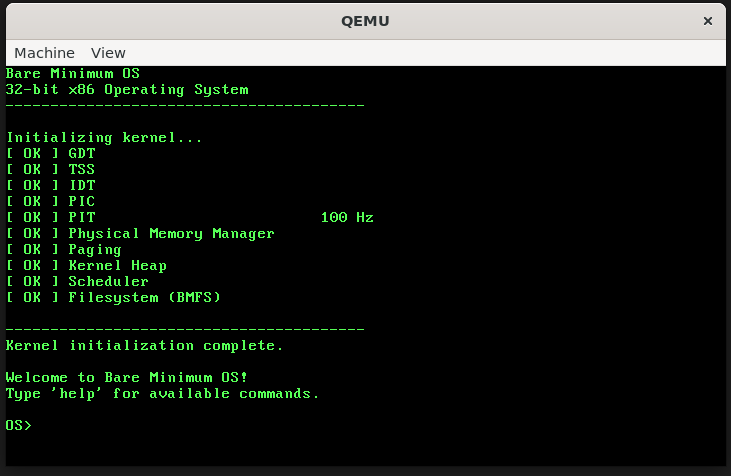
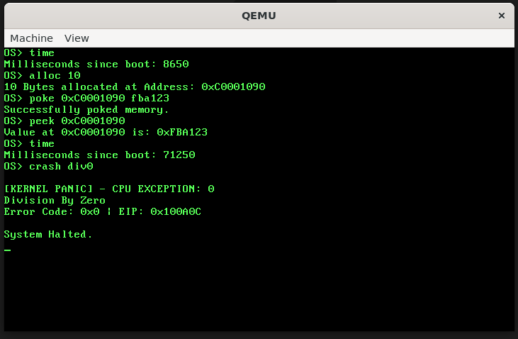
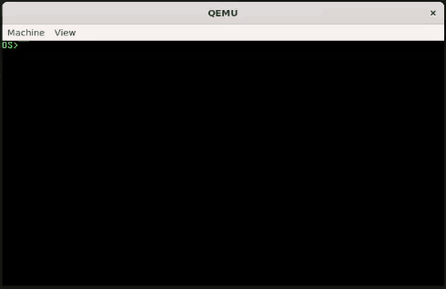
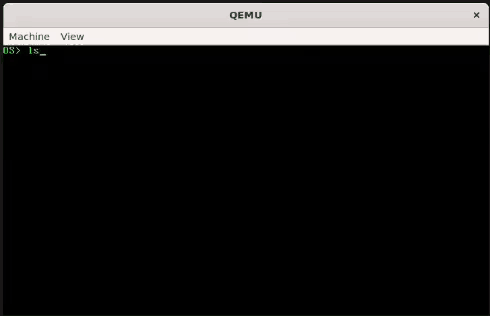
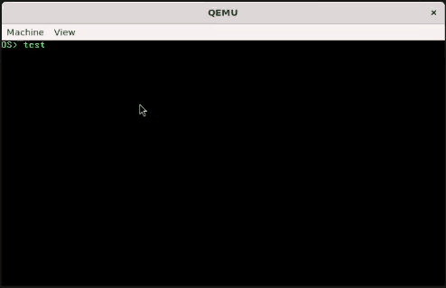

# Bare Minimum OS

A 32-bit i686 operating system written from scratch in C and x86 Assembly.

## Features

- **Boot & CPU:** Custom BIOS LBA bootloader, 32-bit protected mode, GDT/TSS, IDT, PIC, and PIT (100 Hz).
- **Memory Management:** BIOS E820 map parsing, bitmap physical memory manager (PMM),
recursive paging, isolated user address spaces, and a high-memory kernel heap.
- **Multitasking & ELF32 Loader:** Preemptive round-robin scheduler, task sleeping/waiting,
Ring 3 fault isolation, and a multi-segment ELF32 executable loader.
- **Filesystem & Storage:** 28-bit LBA ATA PIO disk driver and persistent filesystem.
- **Console & Shell:** 80x25 VGA driver with a 200-line scrollback buffer, PS/2 keyboard driver, interactive kernel shell, and built-in regression test suite.
- **Userspace (`user/`):** `int 0x80` syscall ABI, freestanding C library (`ulib`), and standalone Ring 3 C applications.

## Build and Run

Requires `i686-elf-gcc`, `i686-elf-binutils`, `nasm`, `python3`, and `qemu-system-i386` (see [Toolchain Setup](docs/toolchain_setup.md)).

```bash
make all          # Build boot.img (bootloader + kernel + BMFS image)
make <app>.elf    # Build a single userspace ELF binary
make check        # Compile all kernel and userspace sources
make run          # Build and run in QEMU
make debug        # Run QEMU with interrupt logging and debug output
make print        # Print discovered sources, objects, and BMFS files
make clean        # Remove build directory
make rebuild      # Clean and rebuild everything
```
NOTE: The `make debug` target runs QEMU with `-debugcon stdio` and logs all interrupts to `qemu-int.log`.
Uncomment the `putchar()` function's `outb(0xE9, c);` line in `src/drivers/vga.c`, so the debug output is visible on the terminal.

## Project Structure

```text
osdev/
├── bugs/         # Bug tracker
├── docs/         # Subsystem documentation
├── include/      # Kernel header files
├── src/          # Bootloader and kernel source files
├── user/         # Ring 3 C library (ulib) and userspace apps
├── linker.ld     # Kernel linker script (0x00100000)
├── Makefile      # Build system
└── mkfs_bmfs.py  # BMFS disk image builder
```

## Documentation

- [Architecture](docs/architecture.md) — Boot flow, memory layout, interrupts, and hardware I/O
- [Memory Management](docs/memory.md) — E820, PMM, paging, address spaces, and kernel heap
- [Multitasking & ELF Loader](docs/multitasking.md) — Scheduler, context switching, and ELF32 loading
- [System Calls & Userspace](docs/syscall.md) — `int 0x80` ABI, pointer validation, and `ulib` runtime
- [Filesystem (BMFS)](docs/filesystem.md) — ATA PIO driver, BMFS layout, and file commands
- [Toolchain Setup](docs/toolchain_setup.md) — Building the `i686-elf` cross-toolchain
- [Bug Tracker](bugs/bugs_summary.md) & [Roadmap](docs/roadmap.md)

## Screenshots & Demos

### Boot & Kernel Initialization


### Kernel Shell & Memory Inspection


### Preemptive Multitasking & Ring 3 Fault Isolation


### BMFS Directories & Persistence Across Reboot


### Kernel Test Suite (251 Tests) & VGA Scrollback


## License

Licensed under the terms of the `LICENSE` file.