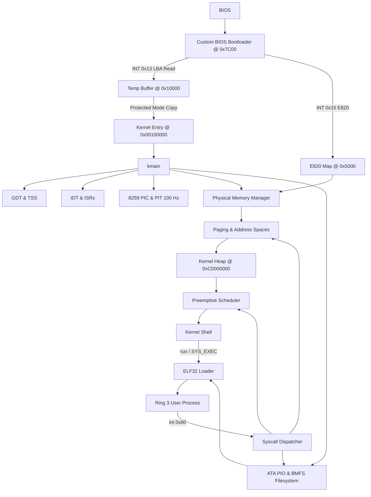
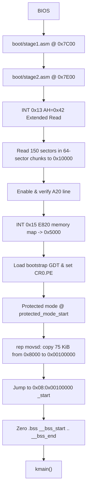

# Kernel Architecture & Design

Bare Minimum OS is a 32-bit i686 operating system with a monolithic kernel implemented in C and x86 Assembly.

The system boots via a custom BIOS bootloader, transitions to 32-bit protected mode, relocates the kernel to `0x00100000` (1 MiB), configures GDT/TSS/IDT/PIC/PIT, initializes physical and virtual memory management, mounts the BMFS disk filesystem via an ATA PIO driver, and launches a preemptively scheduled environment supporting both Ring 0 kernel tasks and Ring 3 ELF32 user processes.

## System Overview

## Physical Memory Map

During boot and kernel initialization, the system uses the following physical memory layout:

| Physical Start | Physical End | Purpose |
|---|---|---|
| `0x00000000` | `0x000003FF` | BIOS Interrupt Vector Table (IVT) |
| `0x00000400` | `0x000004FF` | BIOS Data Area (BDA) |
| `0x00005000` | `0x00005C03` | E820 memory map (`uint32_t` count at `0x5000`, 24-byte entries at `0x5004`, max 128) |
| `0x00006000` | `0x000060FF` | VESA VBE information block (`0x6000`) |
| `0x00007C00` | `0x00007DFF` | Stage 1 bootloader code and data (512-byte boot sector) |
| `0x00007E00` | `0x000085FF` | Stage 2 bootloader code and data (2048-byte boot sector) |
| `0x00010000` | `0x00022BFF` | Temporary real-mode load buffer (`150` sectors = `75 KiB`) |
| `0x000A0000` | — | Initial kernel stack top (`ESP = 0xA0000`) |
| `0x000B8000` | `0x000BFFFF` | VGA text-mode hardware video memory |
| `0x00100000` | `__bss_end` | Relocated kernel image (`.text`, `.rodata`, `.data`, `.bss`, including `idt[256]`) |
| `__bss_end` (page-aligned) | `0xFFFFFFFF` | Usable physical RAM frames managed by the PMM |

## Virtual Memory Map

Once `paging_init()` enables paging, every address space shares the following virtual layout:

| Virtual Start | Virtual End | Size | Purpose |
|---|---|---|---|
| `0x00000000` | `0x003FEFFF` | ~4 MiB | Kernel identity map (BIOS, VGA `0xB8000`, boot stack `0xA0000`, kernel `0x00100000 .. __bss_end`) |
| `0x003FF000` | `0x003FFFFF` | 4 KiB | `PAGING_TEMP_VADDR` (temporary physical frame mapping slot) |
| `0x00400000` | `0xBFFFFFFF` | ~3 GiB | User space (`USER_SPACE_START` to `USER_SPACE_END`; ELF segments at `0x00400000+`, user stack below `0x00801000`) |
| `0xC0000000` | `0xDFFFFFFF` | 512 MiB | Kernel heap (`HEAP_START` to `HEAP_MAX_ADDR`) |
| `0xE0000000` | `0xFFBFFFFF` | ~508 MiB | Reserved high kernel virtual space |
| `0xFFC00000` | `0xFFFFFFFF` | 4 MiB | Recursive paging structures (`0xFFC00000` page tables, `0xFFFFF000` page directory) |

## Boot Process

`boot/stage1.asm` executes at `0x7C00` in 16-bit real mode and loads
`boot/stage2.asm` at `0x7E00`which performs the following steps:

1. Initializes 16-bit segments (`DS = ES = SS = 0`) and stack pointer (`SP = 0x7C00`).
2. Resets the boot drive (`INT 0x13 AH=0x00`) and reads `KERNEL_MAX_SECTORS` (`150` sectors) starting at LBA `1` into `0x0800:0x0000` (`0x8000`) in chunks of up to 64 sectors.
3. Enables and verifies the A20 line (`enable_a20` / `check_a20`), trying BIOS `INT 0x15 AX=0x2401` and falling back to Fast A20 (port `0x92`).
4. Collects up to 128 E820 memory map entries (`INT 0x15 EAX=0xE820`).
5. Loads the bootstrap GDT, sets `CR0.PE = 1`, and jumps to 32-bit `protected_mode_start`.
6. Copies the kernel image from `0x8000` to `0x00100000` (`1 MiB`) and jumps to `_start` (`src/kernel_entry.asm`).
7. `kernel_entry.asm` zeroes `.bss` and calls `kmain()`.

## GDT and TSS

`gdt_init()` installs a 6-entry Global Descriptor Table:

| Index | Selector | Descriptor | Privilege |
|---:|---:|---|---|
| `0` | `0x00` | Null descriptor | — |
| `1` | `0x08` | Kernel code segment | Ring 0 |
| `2` | `0x10` | Kernel data segment | Ring 0 |
| `3` | `0x1B` | User code segment | Ring 3 |
| `4` | `0x23` | User data segment | Ring 3 |
| `5` | `0x28` | Task State Segment (TSS) | Ring 0 |

`tss_init(0xA0000)` zeroes the TSS, sets `ss0 = 0x10` and `esp0 = 0xA0000`, installs the TSS descriptor at GDT index 5, and loads the task register (`ltr 0x28`). Whenever the scheduler switches to a user task, `tss_set_kernel_stack()` updates `tss.esp0` to that task's `kernel_stack_top`.

## Kernel Initialization Order

`kmain()` (`src/kernel.c`) initializes subsystems in the following order:

1. `clear_screen()` — initializes the 200-line VGA scrollback buffer and clears `0xB8000`.
2. `gdt_init()` — loads the 6-entry kernel/user GDT.
3. `tss_init(0xA0000)` — initializes and loads the TSS.
4. `idt_init()` — populates the 256-entry IDT in `.bss` and loads `IDTR`.
5. `pic_init()` — remaps the 8259 PICs to vectors `32–47` and unmasks `IRQ0` (PIT) and `IRQ1` (keyboard).
6. `pit_init(100)` — configures PIT channel 0 to 100 Hz (10 ms tick).
7. `pmm_init()` — parses E820 entries, initializes the frame bitmap, and reserves frames `0 .. pmm_reserved_frames() - 1`.
8. `paging_init()` — sets up recursive paging, identity-maps the first 4 MiB (except `PAGING_TEMP_VADDR`), and enables `CR0.PG | CR0.WP`.
9. `heap_init()` — maps the initial kernel heap page at `0xC0000000`.
10. `scheduler_init()` — creates PID `0` (`kmain`) as the idle task.
11. `fs_init()` — reads and mounts the BMFS superblock at LBA `151`.
12. `task_add(create_task("shell", task_shell))` and `shell_init()` — launches the interactive shell task.
13. `sti` and `hlt` loop — enables hardware interrupts and idles in `kmain`.

## Interrupts, Exceptions, and Hardware I/O Ports

### IDT Vector Assignment

| Vector Range | Source | Handler | Gate DPL |
|---|---|---|---|
| `0–31` | CPU Exceptions | `isr0` – `isr31` | Ring 0 (`0x8E`) |
| `32` (`IRQ0`) | Programmable Interval Timer (PIT) | `isr32` $\rightarrow$ `pit_handler()` | Ring 0 (`0x8E`) |
| `33` (`IRQ1`) | PS/2 Keyboard | `isr33` $\rightarrow$ `keyboard_handler()` | Ring 0 (`0x8E`) |
| `128` (`0x80`) | System Call Interface | `isr128` $\rightarrow$ `syscall_handler()` | Ring 3 (`0xEE`) |

If a CPU exception (`0–31`) occurs while executing in Ring 3 (`(regs->cs & 0x3) == 0x3`), `isr_handler()` prints a `[USER FAULT]` report (including `CR2` fault details on Page Faults) and terminates only the faulting process with exit status `-(128 + int_no)`. Kernel-mode exceptions trigger `[KERNEL PANIC]` and halt the system.

### Hardware I/O Ports Used

| Port(s) | Device / Purpose |
|---|---|
| `0x20`, `0x21` | Master 8259 PIC command and data/mask registers |
| `0xA0`, `0xA1` | Slave 8259 PIC command and data/mask registers |
| `0x40`, `0x43` | PIT channel 0 data and command port |
| `0x60`, `0x64` | PS/2 keyboard data port (`0x60`) and controller command port (`0x64`, `0xFE` system reset) |
| `0x80` | POST diagnostic port used for `io_wait()` delay |
| `0x92` | System Control Port A (Fast A20 fallback in bootloader) |
| `0x1F0–0x1F7` | Primary ATA bus PIO data, sector count, LBA, drive/head, and status/command registers |
| `0x3D4`, `0x3D5` | VGA CRT controller index and data registers (hardware cursor position) |