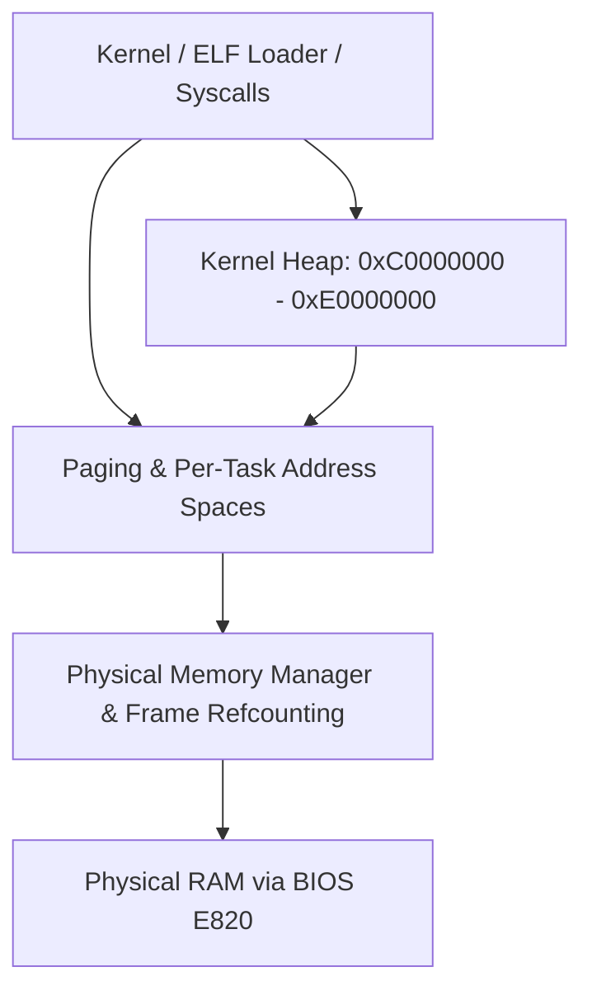

# Memory Management

Bare Minimum OS manages memory across three layers:



## 1. BIOS E820 Memory Map

During boot, `src/bootloader.asm` queries `INT 0x15`, `EAX=0xE820` (`EDX='SMAP'`), requesting 24-byte ACPI 3.0 entries and storing up to `E820_MAX_ENTRIES` (`128`) entries at physical address `0x5000`:

- `0x5000`: `uint32_t` entry count
- `0x5004`: array of `struct mem_map_entry` (24 bytes each):

```c
struct mem_map_entry {
    uint64_t base_addr;
    uint64_t region_length;
    uint32_t region_type;
    uint32_t acpi_attributes;
} __attribute__((packed));
```

## 2. Physical Memory Manager (`src/mm/pmm.c`)

### Dual-Bitmap Design

The PMM tracks all `1,048,576` possible 4 KiB frames in the 4 GiB 32-bit physical address space using two bitmaps (`32,768` `uint32_t` words each):

1. `mem_map`: `1` = allocated/unavailable, `0` = free.
2. `usable_mem_map`: `1` = usable RAM frame, `0` = reserved/non-RAM frame.

### E820 Sanitization and Kernel Reservation

During `pmm_init()`:

1. All frames start marked unavailable (`mem_map = 0xFF`, `usable_mem_map = 0x00`).
2. For each E820 entry:
   - Entries with `(acpi_attributes & E820_ACPI_ENABLED) == 0` or `region_type != 1` (`E820_USABLE`) are ignored.
   - Regions starting at or above 4 GiB are ignored; regions straddling 4 GiB are overflow-safely clipped to `0x100000000ULL`.
   - Region start addresses are rounded **up** to the next 4 KiB boundary, and end addresses are rounded **down** to a 4 KiB boundary, excluding partial leading/trailing pages.
   - Duplicate/overlapping usable regions are deduplicated via `!test_bit_usable(frame)` before incrementing `total_blocks`.
3. **Dynamic Low-Memory & Kernel Reservation:**
   - `pmm_reserved_frames()` computes the frame index of `__bss_end` (minimum `0x00100000` / 256 frames).
   - Every frame from `0x00000000` up to `__bss_end` (covering BIOS data, `0x5000` E820 map, `0xA0000` boot stack, `0xB8000` VGA buffer, and the kernel image + `.bss` at `0x00100000 .. __bss_end`) is marked reserved and unallocatable.

### Allocation, Validation, and Reference Counting

- **Next-Fit Allocation (`pmm_alloc_block`):** Scans `mem_map` starting from `last_searched_idx` for a free, usable frame, marks it allocated, increments `used_blocks`, and returns its physical address.
- **Strict Free Validation (`pmm_free_block`):** Rejects null pointers, non-4 KiB-aligned addresses, frames below `pmm_reserved_frames()`, frames outside `usable_mem_map`, and already-free frames (preventing double-frees).
- **Frame Reference Counting (`pmm_ref_block` / `pmm_get_refcount`):** Tracks shared physical frames across address spaces (up to `PMM_MAX_SHARED_FRAMES = 256`). When a refcounted frame is freed via `pmm_free_block()`, its extra reference count is decremented, and the underlying frame is only released back to the bitmap when the reference count reaches zero.

## 3. Virtual Memory and Paging (`src/mm/paging.c`)

### Virtual Address Space Layout

```text
0xFFFFFFFF +------------------------------------------------------------+
           | Recursive Page Directory & Page Tables (4 MiB)             |
0xFFC00000 +------------------------------------------------------------+
           | Reserved High Kernel Virtual Space (~508 MiB)              |
0xE0000000 +------------------------------------------------------------+
           | Kernel Heap (HEAP_START .. HEAP_MAX_ADDR, 512 MiB)         |
0xC0000000 +------------------------------------------------------------+
           |                                                            |
           | User Space (USER_SPACE_START .. USER_SPACE_END, ~3 GiB)    |
           |   - User Stack Top: 0x00801000 (1 page at 0x00800000)      |
           |   - User ELF Code/Data: 0x00400000+                        |
0x00400000 +------------------------------------------------------------+
0x003FF000 | PAGING_TEMP_VADDR (4 KiB temporary physical mapping slot)  |
           +------------------------------------------------------------+
           | Kernel Identity Map (0x00000000 .. 0x003FEFFF)             |
           |   - Kernel .text/.rodata/.data/.bss at 0x00100000+         |
           |   - VGA Buffer at 0x000B8000, Boot Stack at 0x000A0000     |
0x00000000 +------------------------------------------------------------+
```

### Paging Invariants

1. **Write Protection (`CR0.WP`):** `enable_paging()` sets both `CR0.PG` (Bit 31) and `CR0.WP` (Bit 16), enforcing read-only page protections even when executing in Ring 0.
2. **Temporary Physical Mapping (`paging_temp_map` / `paging_temp_unmap`):** Physical frames allocated by the PMM may reside above 4 MiB (`>= 0x00400000`). Whenever the kernel initializes a new page directory, zeroes a page table, or copies ELF segments into newly allocated frames, it maps the physical frame at `PAGING_TEMP_VADDR` (`0x003FF000`) with interrupts disabled.
3. **User/Kernel Separation:**
   - User mappings (`PTE_USER`) are strictly restricted to `[0x00400000, 0xBFFFFFFF]` and cannot be placed inside kernel-only PDEs (such as PDE `0`).
   - Kernel heap and kernel mappings reside in PDE `0` (`0x00000000`) and PDEs `768–895` (`0xC0000000 – 0xDFFFFFFF`).
4. **Cross-Process Kernel PDE Synchronization:** When `map_page()` allocates a new kernel PDE or `paging_switch_directory()` switches to a user page directory, non-user PDEs from `kernel_page_directory` are synchronized into the target directory so kernel heap expansions are visible in all tasks.
5. **Empty Page-Table Reclamation:** When `unmap_page()` removes the last present PTE from a non-zero PDE, it frees the page-table physical frame, clears the PDE, and invalidates the recursive alias (`invlpg`) at `0xFFC00000 + (pde_idx * 4096)`.

## 4. Kernel Heap (`src/mm/heap.c`)

The kernel heap manages dynamic allocations from `HEAP_START` (`0xC0000000`) up to `HEAP_MAX_ADDR` (`0xE0000000`).

Each allocation is preceded by a `heap_block_t` header:

```c
typedef struct heap_block {
    uint32_t magic;            // HEAP_MAGIC (0xDEADBEEF)
    size_t size;               // Payload size in bytes (8-byte aligned)
    int is_free;               // 1 = free, 0 = allocated
    struct heap_block* next;
} heap_block_t;
```

- **Interrupt-Safe Operations:** `kmalloc()`, `kfree()`, and `heap_is_payload_range()` disable interrupts (`pushfl; cli` / `popfl`) while traversing or mutating the heap list so timer preemption and `reap_dead_tasks()` can never race with heap allocations.
- **Splitting and Coalescing:** Free blocks larger than `size + sizeof(heap_block_t) + 8` are split on allocation; adjacent free blocks are merged by `coalesce_heap()` on `kfree()`.
- **Pointer Verification:** `kfree()` verifies 8-byte alignment, checks that the address lies within `[HEAP_START + sizeof(heap_block_t), heap_end_vaddr)`, walks the block list to confirm the pointer matches a real block header (rejecting interior pointers with fake headers), and ignores double-frees.