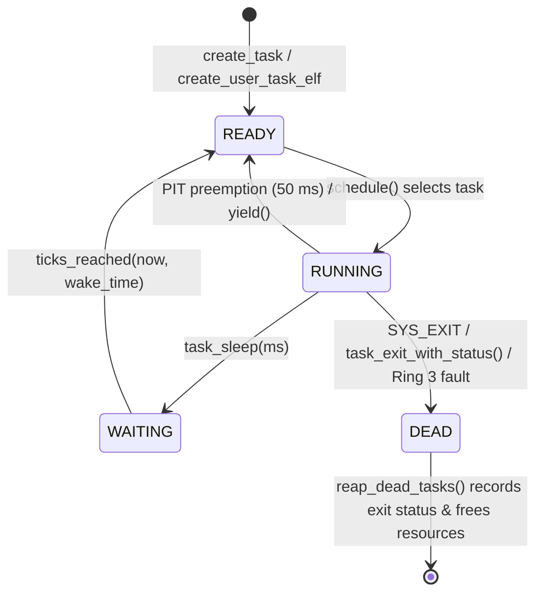

# Multitasking, Scheduling & ELF32 Loader

Bare Minimum OS implements preemptive round-robin multitasking driven by the Programmable Interval Timer (PIT), supporting both Ring 0 kernel threads and isolated Ring 3 ELF32 processes.

## Task Control Block (`task_t`)

Defined in `include/task/task.h`:

```c
typedef enum {
    TASK_READY,
    TASK_RUNNING,
    TASK_WAITING,
    TASK_DEAD
} task_state_t;

typedef struct task {
    uint32_t esp;                // Saved kernel stack pointer
    uint32_t pid;                // Unique non-zero Process ID (0 = kmain idle task)
    const char* name;            // Task name string
    task_state_t state;          // Current scheduling state
    int32_t exit_status;         // Exit code passed to SYS_EXIT / task_exit_with_status

    void* stack_allocation;      // 4 KiB kernel stack allocated from heap
    uint32_t kernel_stack_top;   // Top of kernel stack (loaded into TSS.esp0)
    uint32_t* page_directory;    // Physical address of task's page directory (CR3)

    uint32_t wake_time;          // Target PIT tick count when sleeping
    struct task* next;           // Next task in circular linked list
} task_t;
```

## Task State Lifecycle



## Scheduler Operation (`src/task/scheduler.c`)

1. **Idle Task (`PID 0`):** `scheduler_init()` wraps the initial `kmain` execution context as `PID 0` (`"kmain"`).
2. **Preemption Quantum:** The PIT fires at `100 Hz` (every 10 ms). `pit_handler()` sends the PIC EOI, checks `scheduler_is_idling()`, and calls `schedule()` every 5 ticks (`50 ms`).
3. **Dead Task Reaping & Exit History:**
   - When a task exits via `task_exit_with_status(status)`, its exit code is stored in a 64-entry circular `exit_history` table and its state becomes `TASK_DEAD`.
   - `reap_dead_tasks()` unlinks `TASK_DEAD` nodes from the ring and calls `destroy_task()`, which destroys the task's user page directory (reclaiming all non-shared user frames and page tables) and frees its kernel stack and PCB.
4. **All-Waiting Idle Handling:**
   - If every task in the ring is currently `TASK_WAITING`, `schedule()` sets `scheduler_idling = 1` and executes `sti; hlt; cli` in a loop until a timer interrupt advances `tick_count` to a task's `wake_time`.
5. **Wraparound-Safe Sleep Timing:**
   - `ms_to_ticks()` converts milliseconds to ticks without 32-bit multiplication overflow, and `ticks_reached(now, wake_time)` uses signed modular subtraction `(int32_t)(now - wake_time) >= 0` to handle 32-bit tick counter wraparound cleanly.
6. **Synchronous Process Waiting (`task_wait_pid`):**
   - `task_wait_pid(pid, &status)` yields in a loop while `scheduler_pid_exists(pid)` is true, then retrieves the child's exit code from `exit_history`.

## Context Switching (`src/task/switch.asm`)

When `schedule()` selects a new task:

1. `tss_set_kernel_stack()` sets `tss.esp0` to `current_task->kernel_stack_top` (or `0xA0000` for `PID 0`).
2. `paging_switch_directory()` synchronizes kernel PDEs and loads the task's `page_directory` into `CR3`.
3. `switch_task(&previous_task->esp, &current_task->esp)` pushes `EFLAGS` and `pushad` onto the old kernel stack, saves `ESP`, loads the new task's `ESP`, pops `popad` and `EFLAGS`, and executes `ret`.

## ELF32 Executable Loader (`src/task/elf.c`)

User applications in `user/*.c` are compiled and linked into standalone 32-bit x86 ELF executables (`.elf`) and stored in the BMFS disk filesystem.

### Validation (`elf_validate`)

Before allocating any memory, `elf_validate(image, size)` verifies:

1. **ELF Header (`Elf32_Ehdr`):** Magic bytes (`\x7FELF`), `ELFCLASS32`, `ELFDATA2LSB`, version `1`, `ET_EXEC`, `EM_386`, and valid program header table bounds (`e_phoff + e_phnum * e_phentsize <= size`).
2. **Program Headers (`Elf32_Phdr`):**
   - At least one non-empty `PT_LOAD` segment exists.
   - `p_filesz <= p_memsz` and file offsets `p_offset + p_filesz <= size`.
   - Virtual addresses reside strictly inside `[USER_SPACE_START, USER_SPACE_END]` (`0x00400000 – 0xBFFFFFFF`), do not overlap the user stack page (`0x00800000 – 0x00800FFF`), and do not overlap any other `PT_LOAD` segment on the same page.
   - The entry point `e_entry` lies within an executable (`PF_X`) `PT_LOAD` segment.

### Segment Loading (`create_user_task_elf`)

1. Creates an isolated page directory via `paging_create_address_space()`.
2. Iterates over all non-empty `PT_LOAD` segments:
   - Allocates physical frames for each page spanned by `[p_vaddr, p_vaddr + p_memsz)`.
   - Temporarily maps each physical frame at `PAGING_TEMP_VADDR`, zeroes the entire 4 KiB page (automatically zero-filling `.bss` and sub-page padding), and copies the segment's file bytes (`p_filesz`).
   - Maps the page into the user address space with `PTE_PRESENT | PTE_USER`, adding `PTE_RW` only if the segment carries `PF_W` (keeping `.text` and `.rodata` read-only).
3. Allocates and maps a 4 KiB writable user stack page at `USER_STACK_TOP_ADDR - PAGE_SIZE` (`0x00800000`).
4. Allocates the `task_t` PCB and 4 KiB kernel stack, forges the initial stack frame for `enter_usermode(ehdr->e_entry, USER_STACK_TOP_ADDR)`, and assigns a unique PID.