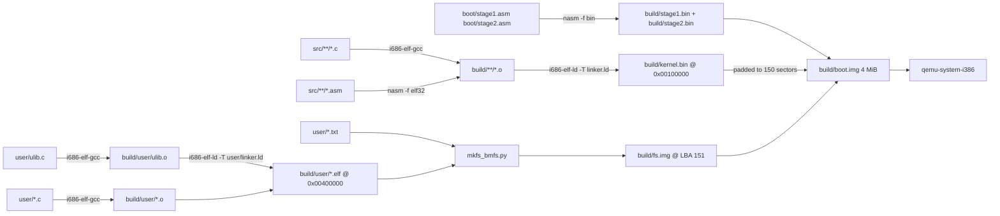

# Toolchain Setup (i686-elf-gcc)

Bare Minimum OS is built using a freestanding `i686-elf` cross-toolchain rather than the host system's native compiler.

The repository expects the cross-toolchain in `cross/bin/` (or available via the `CROSS` variable in `Makefile`):

```text
cross/
└── bin/
    ├── i686-elf-gcc
    ├── i686-elf-ld
    ├── i686-elf-objcopy
    ├── i686-elf-objdump
    └── ...
```

## 1. Install Prerequisites

On a Debian/Ubuntu system:

```bash
sudo apt update
sudo apt install build-essential bison flex libgmp3-dev libmpc-dev libmpfr-dev texinfo wget git nasm python3 qemu-system-x86
```

## 2. Download Toolchain Sources

```bash
wget https://ftp.gnu.org/gnu/binutils/binutils-2.41.tar.gz
wget https://ftp.gnu.org/gnu/gcc/gcc-13.2.0/gcc-13.2.0.tar.gz
tar -xvf binutils-2.41.tar.gz
tar -xvf gcc-13.2.0.tar.gz
mkdir build-binutils build-gcc
```

## 3. Build Binutils (`2.41`)

Assuming the repository is at `~/osdev`:

```bash
cd ~/osdev/build-binutils
../binutils-2.41/configure \
  --target=i686-elf \
  --prefix="$HOME/osdev/cross" \
  --disable-nls \
  --disable-werror
make -j$(nproc)
make install
```

## 4. Build GCC (`13.2.0`)

```bash
cd ~/osdev/build-gcc
../gcc-13.2.0/configure \
  --target=i686-elf \
  --prefix="$HOME/osdev/cross" \
  --disable-nls \
  --enable-languages=c \
  --without-headers
make all-gcc -j$(nproc)
make all-target-libgcc -j$(nproc)
make install-gcc
make install-target-libgcc
```

## 5. Build Pipeline Overview

The root `Makefile` automatically discovers all kernel sources under `src/` and all userspace applications/data files under `user/`:

